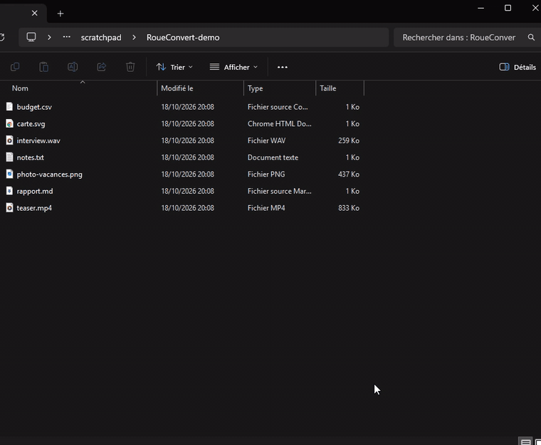

# RoueConvert

**Ctrl + clic gauche** sur n'importe quel fichier dans l'Explorateur Windows ou sur le Bureau : une roue
s'ouvre autour du curseur avec tous les formats « logiques » de ce fichier. Tu cliques sur un format et
une **copie convertie** est créée juste à côté. L'original n'est jamais modifié.

<p align="center">
  
</p>

<p align="center"><i>PNG → JPG, Markdown → PDF, MP4 → GIF animé, sans quitter l'Explorateur.</i></p>

---

## Sommaire

- [Installation](#installation)
- [Utilisation](#utilisation)
- [Formats pris en charge](#formats-pris-en-charge)
- [Détails des conversions](#détails-des-conversions)
- [L'icône de la barre des tâches](#licône-de-la-barre-des-tâches)
- [Comment ça marche](#comment-ça-marche)
- [Compiler depuis les sources](#compiler-depuis-les-sources)
- [Limites connues](#limites-connues)
- [Désinstaller](#désinstaller)

---

## Installation

1. Télécharge **`RoueConvert.exe`** depuis la [dernière release](https://github.com/VaticUI/RoueConvert/releases/latest).
2. Mets-le où tu veux (par exemple `Documents\RoueConvert\`) et lance-le.
3. Une petite roue colorée apparaît dans la zone de notification, à côté de l'horloge. C'est prêt.

Il n'y a rien d'autre à installer : le programme utilise le .NET Framework 4.8, présent d'origine sur
Windows 10 et 11.

### Outils optionnels

Certaines conversions s'appuient sur des outils externes. S'ils sont absents, les formats correspondants
n'apparaissent simplement pas dans la roue.

| Outil | Sert à | Comment l'obtenir |
|---|---|---|
| **ffmpeg** | audio, vidéo, GIF animé depuis une vidéo, WebP, lecture HEIC/AVIF | `winget install ffmpeg` (ou `ffmpeg.exe` posé à côté de `RoueConvert.exe`) |
| **Microsoft Edge** | documents → PDF, rendu des SVG | déjà installé sur Windows 10/11 (Chrome fonctionne aussi) |

Le menu de l'icône indique quels outils ont été trouvés (✓ / ✗).

---

## Utilisation

1. Dans l'Explorateur ou sur le Bureau, **maintiens Ctrl et clique gauche** sur un fichier.
2. La roue s'ouvre centrée sur le curseur :
   - au **centre** : le format actuel et le nom du fichier ;
   - autour : les formats cibles, **colorés par famille** (bleu = image, rouge = PDF, violet = audio,
     orange = vidéo, vert = texte, jaune = données, turquoise = vectoriel).
3. Survole un format pour le mettre en avant, puis **clique** dessus.
4. Le centre affiche la progression (anneau + pourcentage pour l'audio et la vidéo), puis **✓ Terminé**
   avec le nom du fichier créé. La roue se ferme toute seule.

### Raccourcis dans la roue

| Action | Effet |
|---|---|
| Clic sur un format | lance la conversion |
| `1` … `9` | choisit le 1er … 9e format (dans le sens des aiguilles d'une montre, depuis le haut) |
| `Entrée` | convertit vers le format survolé |
| `Échap`, clic droit, clic en dehors | ferme la roue |

### Où va le résultat ?

Le nouveau fichier est créé **dans le même dossier**, avec le même nom et la nouvelle extension :

```
photo.png   →  photo.jpg
photo.png   →  photo (1).jpg      si photo.jpg existe déjà
rapport.pdf →  rapport - page 1.png, rapport - page 2.png, …   (PDF de plusieurs pages)
```

En cas d'échec (fichier protégé, codec manquant, dossier en lecture seule…), le centre de la roue devient
rouge avec le message d'erreur ; aucun fichier partiel n'est laissé.

### Sur quoi ça réagit

- Fichiers dans une fenêtre de l'**Explorateur** (onglets de Windows 11 compris), quel que soit
  l'affichage (détails, icônes, liste…), et que les extensions soient affichées ou masquées.
- Fichiers sur le **Bureau**.
- Si le Ctrl + clic tombe sur un dossier, un raccourci, un fichier sans conversion possible ou du vide,
  RoueConvert le laisse passer : Windows fait son comportement habituel (ajouter à la sélection).

---

## Formats pris en charge

| Famille | Source | Peut devenir |
|---|---|---|
| 🖼️ Images | `png` `jpg` `bmp` `tiff` `ico` `webp` | `png` `jpg` `webp` `bmp` `gif` `tiff` `ico` `pdf` |
| 🎞️ GIF | `gif` | `png` `jpg` `webp` `bmp` `tiff` `pdf` `mp4` `webm` |
| 📱 Photos modernes | `heic` `avif` | `jpg` `png` `webp` `bmp` `tiff` `pdf` |
| ✏️ Vectoriel | `svg` | `png` `jpg` `pdf` `ico` |
| 📄 PDF | `pdf` | `png` `jpg` (une image par page) |
| 🎵 Audio | `mp3` `wav` `flac` `ogg` `m4a` `opus` `aac` `wma` `aiff` | `mp3` `wav` `flac` `ogg` `m4a` `opus` |
| 🎬 Vidéo | `mp4` `mkv` `webm` `mov` `avi` `wmv` `flv` `m4v` `mpg` `ts` `3gp` | `mp4` `mkv` `webm` `mov` `avi` `gif` `mp3` `wav` |
| 📝 Texte | `txt` | `md` `html` `docx` `rtf` `pdf` |
| 📝 Markdown | `md` | `html` `docx` `txt` `pdf` |
| 🌐 Web | `html` `htm` | `pdf` `docx` `md` `txt` |
| 📘 Word | `docx` | `pdf` `txt` `html` `md` `rtf` |
| 📃 Texte riche | `rtf` | `docx` `pdf` `txt` `html` `md` |
| 📊 Tableurs | `csv` `tsv` | `xlsx` `json` + `csv`/`tsv` |
| 📊 Excel | `xlsx` | `csv` `json` |
| 🧩 Données | `json` | `csv` `xml` `yaml` |
| 🧩 Données | `xml` | `json` |

Les variantes d'extension sont reconnues : `jpeg`/`jfif` → `jpg`, `tif` → `tiff`, `htm` → `html`,
`markdown` → `md`, `yml` → `yaml`, `log` → `txt`…

---

## Détails des conversions

### Images
- Décodage et encodage par **WIC**, le moteur d'images de Windows.
- L'**orientation EXIF** des photos de téléphone est appliquée (plus de photos couchées).
- Vers JPG, BMP et PDF, la transparence est posée sur un **fond blanc**.
- **ICO** : icône multi-tailles (16, 24, 32, 48, 64, 128, 256 px), l'image est centrée dans un carré transparent.
- **PDF** : une page à la taille de l'image.
- **WebP**, et la lecture des formats que Windows ne sait pas ouvrir (HEIC, AVIF…), passent par ffmpeg.
- Depuis un `.ico`, c'est la plus grande taille qui est utilisée ; depuis un GIF animé, la première image.

### SVG
Rendu par Edge en arrière-plan, avec la transparence conservée en PNG. Les petits SVG sont agrandis à
1024 px sur le plus grand côté pour rester nets.

### PDF → images
Rendu par le moteur PDF intégré à Windows (`Windows.Data.Pdf`), à environ 200 dpi. Chaque page donne un
fichier. Les PDF protégés par mot de passe sont refusés.

### Audio et vidéo (ffmpeg)
| Cible | Réglage |
|---|---|
| MP3 | LAME VBR qualité 2 (~190 kbit/s) |
| WAV / FLAC | PCM 16 bits / sans perte |
| OGG / Opus / M4A | Vorbis q5 / Opus 128 kbit/s / AAC 192 kbit/s |
| MP4 / MOV | H.264 CRF 20 + AAC, lecture rapide sur le web (`faststart`) |
| MKV | copie directe des flux (instantané), sinon réencodage H.264 |
| WebM | VP9 + Opus |
| AVI | MPEG-4 + MP3 |
| GIF | 12 images/s, 480 px de large max, palette optimisée |

Vidéo → MP3/WAV extrait la bande-son. La roue affiche le pourcentage d'avancement.

### Documents
Chaque document est lu dans un modèle commun (titres, paragraphes, gras/italique, code, liens, listes à
puces et numérotées, citations, tableaux, séparateurs), puis réécrit dans le format choisi.
- **DOCX** généré avec de vrais styles Word (Titre 1–6, listes, tableau quadrillé, code).
- **PDF** : le document passe en HTML mis en page, puis Edge l'imprime en PDF (A4). Un `.html` source est
  imprimé tel quel, avec ses images et son style.
- **TXT** : chaque ligne du texte est conservée.
- Les images contenues dans un DOCX ou un RTF ne sont pas reprises.

### Données
- **CSV** : le séparateur est détecté automatiquement (`;` `,` tabulation `|`). Les CSV produits utilisent le
  séparateur de ta langue (`;` en français, comme Excel) et l'UTF-8 avec BOM, donc Excel affiche bien les accents.
- **XLSX** : première feuille lue ; à l'écriture, la ligne d'en-tête est en gras et figée, les nombres sont de
  vrais nombres et les colonnes sont dimensionnées.
- **JSON → CSV** : un tableau d'objets donne une ligne par objet ; les objets imbriqués sont aplatis
  (`adresse.ville`). Si le JSON est un objet qui contient un tableau d'objets, c'est ce tableau qui est utilisé.
- **CSV → JSON** : la première ligne sert de clés, et les nombres et booléens sont typés.
- **XML → JSON** : les attributs deviennent `@nom` et les éléments répétés deviennent des tableaux.

---

## L'icône de la barre des tâches

Clic droit sur la roue colorée près de l'horloge :

| Menu | Rôle |
|---|---|
| **Activé** | met RoueConvert en pause sans le quitter (Ctrl + clic redevient normal) |
| **Lancer au démarrage de Windows** | ajoute / retire RoueConvert du démarrage (registre utilisateur, sans droits admin) |
| Outils : ffmpeg ✓ · Edge ✓ | indique quels outils externes ont été trouvés |
| **Quitter** | ferme le programme |

Une seule instance peut tourner à la fois.

---

## Comment ça marche

```
Ctrl + clic ──► hook souris global (thread dédié, ne ralentit jamais la souris)
                 │  la fenêtre sous le curseur est-elle une vue de fichiers ?
                 │  (Explorateur : DirectUIHWND / Bureau : SysListView32)
                 ├─ non ──► le clic passe normalement
                 └─ oui ──► clic intercepté
                             │
                  UI Automation : nom de l'élément sous le curseur
                  Shell COM     : dossier de la fenêtre (le bon onglet sous Windows 11)
                             │
                  fichier convertible ? ── non ──► le Ctrl + clic est rejoué tel quel
                             │ oui
                  roue WPF transparente sur l'écran concerné (multi-écrans, DPI par écran)
                             │ choix
                  conversion en arrière-plan ──► WIC · Windows.Data.Pdf · ffmpeg · Edge · code maison
```

- Les fenêtres transparentes plein écran (overlay NVIDIA, Discord…) ne gênent pas la détection.
- Si les extensions sont masquées dans l'Explorateur, le vrai fichier est retrouvé sur le disque.
- Les formats DOCX, XLSX, ICO et PDF (images) sont écrits par RoueConvert lui-même, sans Office ni
  bibliothèque externe.

### Structure du code

| Fichier | Rôle |
|---|---|
| `src/App.cs` | point d'entrée, icône de notification, démarrage automatique |
| `src/ClickWatcher.cs` | hook souris global, interception et rejeu du clic |
| `src/ShellResolver.cs` | retrouve le fichier sous le curseur (UI Automation + Shell COM) |
| `src/WheelWindow.cs` | la roue (WPF), animations, progression |
| `src/Formats.cs` | table des conversions possibles par extension |
| `src/Converter.cs` | aiguillage vers le bon moteur, nom du fichier de sortie |
| `src/ImageConv.cs` · `PdfWriter.cs` · `PdfRender.cs` | images, image → PDF, PDF → images |
| `src/Media.cs` · `Edge.cs` · `Tools.cs` | ffmpeg, Edge headless, recherche des outils |
| `src/DocConv.cs` · `DataConv.cs` | documents texte, données tabulaires et structurées |
| `src/Cli.cs` | version console pour tester |

---

## Compiler depuis les sources

Aucun SDK n'est nécessaire : le script utilise le compilateur C# fourni avec Windows.

```powershell
git clone https://github.com/VaticUI/RoueConvert.git
cd RoueConvert
.\build.ps1
```

Cela produit dans `bin\` :
- `RoueConvert.exe` : l'application ;
- `RoueConvert.Cli.exe` : une version console pour tester sans interface.

```powershell
bin\RoueConvert.Cli.exe tools                     # outils détectés
bin\RoueConvert.Cli.exe targets photo.png         # formats proposés
bin\RoueConvert.Cli.exe convert photo.png webp    # conversion directe
bin\RoueConvert.Cli.exe probe 800 450             # quel fichier est sous ce point de l'écran ?
bin\RoueConvert.exe --wheel photo.png             # affiche la roue au curseur pour ce fichier
```

Le code est en C# 5 (la version du compilateur intégré), avec WPF pour l'interface.

---

## Limites connues

- Un Ctrl + clic sur un fichier **convertible** ouvre la roue au lieu de l'ajouter à la sélection.
  Pour sélectionner plusieurs fichiers, utilise Maj + clic, un cadre de sélection, ou mets RoueConvert en pause
  depuis l'icône.
- Ne fonctionne pas dans les boîtes de dialogue « Ouvrir / Enregistrer sous » des autres applications.
- Les conversions de documents conservent la structure et la mise en forme simple, mais pas les mises en
  page complexes, les images intégrées aux DOCX/RTF, ni les formules Excel (seules les valeurs sont lues).
- Seule la première feuille d'un classeur XLSX est convertie.
- Si l'Explorateur est lancé en administrateur, RoueConvert doit l'être aussi pour l'atteindre.

---

## Désinstaller

1. Clic droit sur l'icône → décoche **Lancer au démarrage de Windows**, puis **Quitter**.
2. Supprime `RoueConvert.exe`.

RoueConvert n'écrit rien d'autre sur le disque que tes fichiers convertis. Ses fichiers temporaires vont
dans `%TEMP%\RoueConvert` et sont supprimés après chaque conversion.
